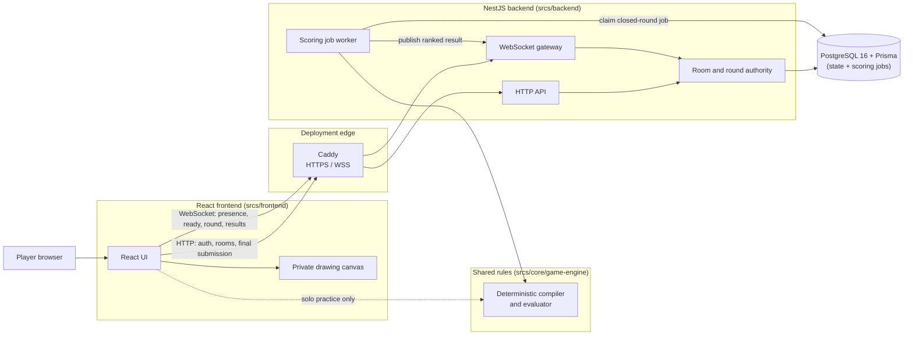

# Project Transcendence — Cube Challenge Multiplayer

<!-- DOC_META: status=review version=2 -->
<!-- DOC_SYNC: Review after changes to project scope, architecture, gameplay, stack, protocols, deployment, or directory ownership. -->

## 1. Project vision

<!-- DOC_TODO: OVERVIEW_SCOPE_REVIEW — reconfirm gameplay scope and capacity after team review. -->

Cube Challenge Multiplayer turns a short perspective-drawing drill into a
game. Given the closest visible face of a cube as a solid reference, a player
freehand-draws the other visible edges, submits the result, and receives
perspective feedback and a score that rewards both accurate strokes and
finishing every target path. The minimum presentation uses a three-point
perspective cube: the reference face is not a drawing requirement and never
receives feedback.
<!-- DOC_TODO: OVERVIEW_CHALLENGE_GENERATION — define finalized CreatorDraft ranges and the required visibility rules for target edges before publishing user-created challenges. -->

Challenge creation is a local authoring flow: it compiles a metric cube and a
center-tracking camera through orthographic, perspective, or equidistant
curvilinear-fisheye projection, assigns every projected edge a persisted role,
and saves an editable source draft beside the authoritative `Challenge` JSON
later stored by the backend. It is not a player-facing drawing mode.

- **Solo practice** is the smallest complete learning loop.
- **Multiplayer** supports rooms of 1–4 simultaneous players. Every player
  receives the same prompt and server-controlled timer, but draws on a private
  canvas. The server calculates and publishes the ranked result.
- The game has clear rules, a time limit, and a win/loss/tie result. It is not
  a general drawing application or a shared-canvas collaboration tool.

The core reference is the gameplay loop of daromeon’s Cube Challenge: infer a
cube from one face, draw the rest, and learn from immediate feedback. No code,
artwork, or assets are reused.

## 2. Tech stack and scope boundary

- **Frontend:** React (JSX), TypeScript, Tailwind CSS for the lobby, drawing
  surface, feedback, and results UI.
- **Backend:** NestJS on Node.js with TypeScript for validation, room and round
  state, WebSocket notifications, and authoritative scoring.
- **Database:** PostgreSQL with Prisma for relational user, room, round,
  submission, result, and claimable scoring-job data. PostgreSQL is also the
  initial durable queue for closed-round scoring; no separate queue service is
  introduced until measured queue delay or database contention requires one.
- **Game engine:** TypeScript implements all game rules, challenge generation,
  stroke evaluation, and scoring. Browser and server code compile to JavaScript.

The game uses browser pointer events for drawing and keyboard events for
shortcuts and accessible controls. React owns application screens and static UI;
the drawing surface and any animation loop remain outside React state updates.
Game rules and network message types must remain independent of the browser UI,
database, and NestJS framework so the server can validate every submission.

The product deliberately excludes infinite-canvas coordinates, paint tools,
colour mixing, screenshots, kitbashing, live shared strokes, chat, and general
asset management.

### Protocol boundary

- **HTTP** handles authentication, room creation/joining, and final drawing
  submission (`POST /rounds/:roundId/submission`).
- **WebSocket** communicates room presence, ready state, round start/end
  (`RoundPrompt`), disconnect/reconnect, and result publication. It never
  streams live drawing strokes.
- **Validation boundary:** TypeScript types do not validate runtime input; the
  server validates untrusted client payloads once at the HTTP/WebSocket entry
  point before persisting or evaluating them.

## 3. Game flow

1. A player chooses solo practice or creates/joins a multiplayer room.
2. A multiplayer room starts only with 1–4 ready participants.
3. The server assigns every player a public round prompt and start/end
   timestamp. It retains the full scoring challenge until result publication.
4. Each player freehand-draws the missing edges on their own canvas.
5. The server freezes each accepted final drawing, then evaluates every
   participant's drawing together when the round closes.
6. The result view shows every final drawing, score, rank, point feedback, and
   correct perspective guides.

The server is authoritative for capacity, room membership, timestamps,
submission acceptance, scoring, and final rankings. Clients never determine
the winner.

## 4. Directory structure and AI policy

- `srcs/md/`: reviewed architectural decisions and specifications.
- `srcs/frontend/`: React application.
- `srcs/backend/`: NestJS application, Prisma schema, and migrations.
- `srcs/core/game-engine/`: dependency-free TypeScript game rules shared by the
  frontend and backend applications. It receives and returns documented game
  data only; browser rendering, HTTP, database, and NestJS concerns stay at the
  edges.
- `.scratch/tmp/` and `.scratch/plan/`: disposable planning and generated
  material; decisions require human review before promotion.
- `tasks/`: Tatr creates, lists, and queries task records; teammates maintain
  their Markdown title, body, and metadata for standups, blockers, decisions,
  and workflow without moving or renaming Tatr HUID directories.
- `dev-tools/`: shared repository verification tools such as
  `dev-tools/doc-check.sh`.
- `setup/` and `build/`: Docker/Podman configuration.

## 5. First vertical slice

1. Render one challenge and collect freehand strokes in a solo browser flow.
2. Submit strokes to a server-side deterministic scorer and show feedback.
3. Add a 1–4-player room, ready state, synchronized timer, and private
   attempts.
4. Persist final submissions and publish the ranked results.
5. Test the complete flow on separate machines before optional features.

No optional mode or social feature starts until this loop works end to end.
